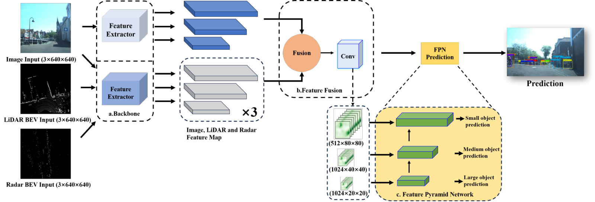
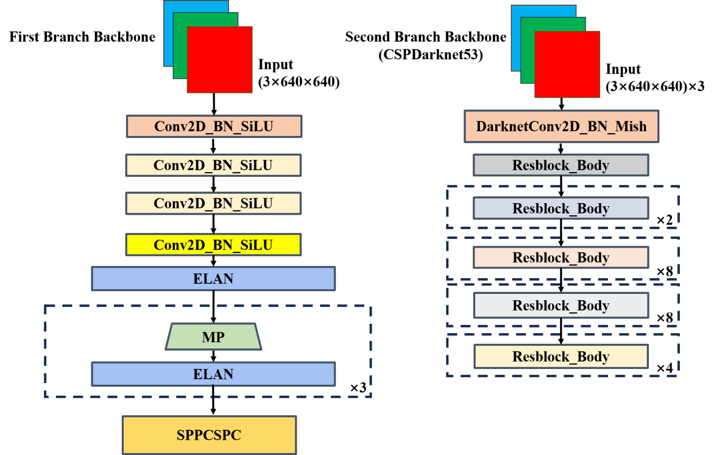
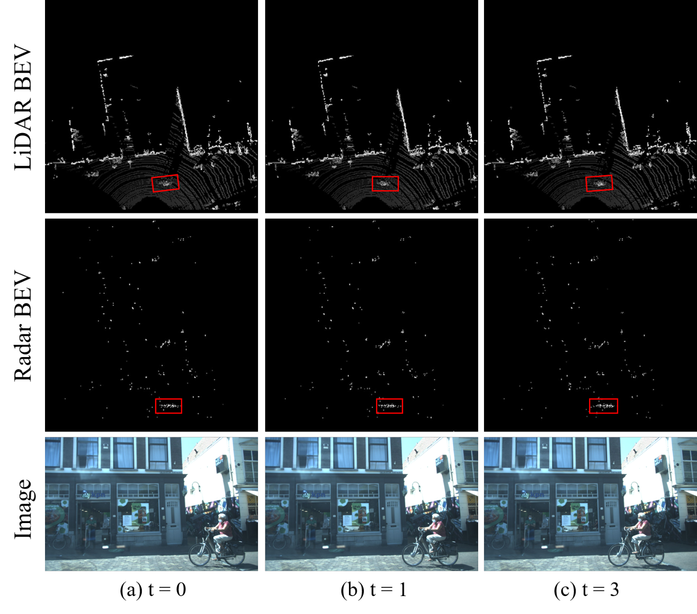
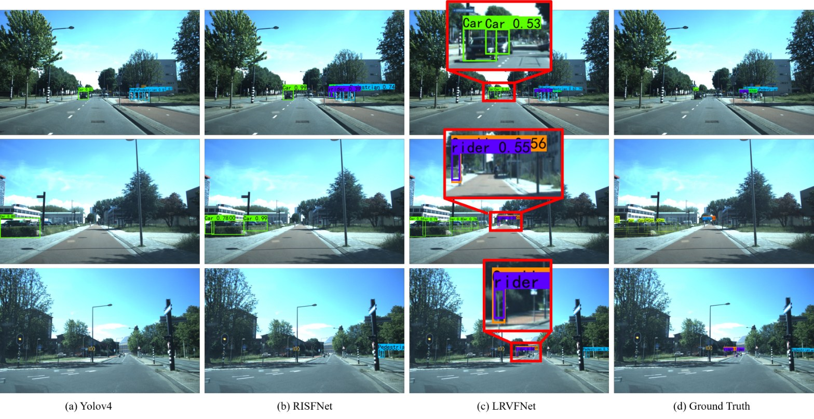

# LRVFNet

[](https://doi.org/10.3390/rs15184433)
[](https://huggingface.co/yuhan-xiao/LRVFNet)
[](https://nubot-nudt.github.io/LRVFNet/)
[](https://pytorch.org)
[](LICENSE)

Official PyTorch implementation of **Deep LiDAR-Radar-Visual Fusion for Object
Detection in Urban Environments** (Remote Sensing 2023, 15(18), 4433).

LRVFNet fuses a monocular RGB image with LiDAR BEV and mmWave-radar BEV maps to
detect objects in urban driving scenes. It consists of three modules:

1. **Two-branch backbone** — YOLOv7-style ELAN backbone for the image, and
   **CSPDarknet53** for the two BEV inputs.
2. **Feature fusion module** — per-modality self-attention (MLP + Conv) followed
   by a shared global-attention gate, applied at three feature scales.
3. **Feature pyramid network** — PANet-style neck with YOLO heads
   (P3/P4/P5 → 80²/40²/20²).

```
RGB 640×640×3 ──► Image backbone  (ELAN) ─────────────┐
LiDAR BEV 640×640×3 ──► CSPDarknet53 ──┐              │
Radar BEV 640×640×3 ──► CSPDarknet53 ──┴─► Fusion ──► FPN ──► heads
                                             ▲               (×3 scales)
```

Input tensor is **9 channels**: `0:3` RGB, `3:6` LiDAR BEV, `6:9` radar BEV.



<sub>Pipeline of LRVFNet.</sub>



<sub>Two-branch backbone: ELAN for the image, CSPDarknet53 for the BEV inputs.</sub>

## Environment

Python 3.10 + PyTorch 1.13.1 (CUDA 11.7). Tested on an RTX 2060 (6 GB).

The environment is managed with [uv](https://docs.astral.sh/uv/): the Python
version, the CUDA 11.7 index and every pinned version live in `pyproject.toml`,
and `uv.lock` freezes the full resolution.

```bash
uv sync          # creates .venv (Python 3.10) and installs the locked versions
uv run python train.py
```

`requirements.txt` is kept for plain-pip users; note that PyTorch CUDA wheels
come from a separate index there.

## Quickstart — run the pipeline on synthetic data

No dataset needed; this verifies the whole chain in a couple of minutes.

```bash
python tools/make_dummy_dataset.py --n 16   # random images + BEV + VOC XML
python tools/build_annotations.py           # writes 2007_{train,val,test}.txt
python train.py                             # see "Training" for the config
python tools/test_predict.py                # one-shot inference on a sample
```

`tools/make_dummy_dataset.py` produces the exact layout `tools/build_annotations.py`
expects, so it doubles as documentation of the data format.

`train.py` ships with the paper's settings (300 epochs, `pretrained=True`). For a
quick end-to-end check set `UnFreeze_Epoch = 1`, `Freeze_Epoch = 0`,
`Freeze_Train = False`, `pretrained = False` and `Unfreeze_batch_size = 2` first;
a few hundred frames are enough, the built-in guard rejects datasets that are too
small for one batch of the validation split.

## Datasets

The paper reports results on two public datasets. Both are released **on request**,
so download them before anything else.

| Dataset | Content | Where |
|---|---|---|
| **View-of-Delft (VoD)** — 8,693 synchronised urban frames, 13 classes | 64-beam LiDAR, 3+1D mmWave radar, stereo camera | request form: [intelligent-vehicles.org/datasets/view-of-delft](https://intelligent-vehicles.org/datasets/view-of-delft/) · devkit: [tudelft-iv/view-of-delft-dataset](https://github.com/tudelft-iv/view-of-delft-dataset) |
| **FloW** (ICCV 2021) — floating-waste detection on inland waters | camera + 77 GHz FMCW radar, including the FloW-RI image/radar subset | repo (see its README for the access form): [ORCAUBOAT/FloW-Dataset](https://github.com/ORCAUBOAT/FloW-Dataset) |

Citations for both are in the paper (refs. 9 and 10). The converter below is
written for VoD's KITTI-style release; FloW needs the same treatment (image +
LiDAR/radar BEV + VOC boxes), which is a matter of replacing the input reader in
`tools/vod_to_voc.py`.

## Training on real data

This repository consumes the datasets in a VOC layout:

```
VOCdevkit/VOC2007/
├── JPEGImages/<id>.jpg        RGB image
├── LRVF/<id>_1.jpg            LiDAR BEV   (0.1 m grid, height 0-255)
├── LRVF/<id>_2.jpg            radar BEV
├── Annotations/<id>.xml       VOC XML
└── ImageSets/Main/{train,val,test}.txt
```

BEV generation follows the paper (§3.1): project points onto a 0.1 m grid over
`X∈[0,40] m, Y∈[-20,20] m, Z∈[-2,0.5] m`, keep the maximum height per cell and
normalise it to 0-255.



<sub>Input modalities: RGB image, LiDAR BEV and radar BEV over consecutive frames.</sub>

Convert a VoD release (KITTI-style) with:

```bash
python tools/vod_to_voc.py --vod /path/to/vod --out VOCdevkit/VOC2007
```

It reads `lidar/training/{image_2,velodyne,radar_3_scans,label_2}`, writes the
layout above (2D boxes come straight from the VoD KITTI labels), and splits the
data 70/15/15. `tools/make_dummy_vod.py` generates a fake VoD tree so the
converter can be tested without downloading anything.

## Pretrained weights

| File | Size | Source |
|---|---|---|
| `CSPdarknet53_backbone_weights.pth` | 102 MB | [huggingface.co/yuhan-xiao/LRVFNet](https://huggingface.co/yuhan-xiao/LRVFNet) |

The BEV backbones load it automatically when `pretrained=True` (see
`models/bev_backbone.py`); the code falls back to the original release URL if the
Hub is unreachable. It is a PyTorch conversion of the CSPDarkNet-53 backbone
originally released in Darknet format by
[WongKinYiu/CrossStagePartialNetworks](https://github.com/WongKinYiu/CrossStagePartialNetworks)
(CSPNet, CVPR 2020), taken from the MIT-licensed
[bubbliiiing/yolov4-pytorch](https://github.com/bubbliiiing/yolov4-pytorch) v1.0
release and mirrored here for link stability.

The image branch uses the YOLOv7 backbone weights released by
[bubbliiiing/yolov7-pytorch](https://github.com/bubbliiiing/yolov7-pytorch)
(`phi='l'` → `yolov7_backbone_weights.pth`, `phi='x'` → `yolov7_x_...`).

## Training

Paper settings are marked ★.

| Parameter | Value |
|---|---|
| Input | 640×640, 9 channels |
| `phi` | `l` (YOLOv7 / yolov7_x if `x`) |
| Optimizer | SGD, momentum 0.937 |
| Init / min LR ★ | 1e-3 / decayed cosine |
| Batch size ★ | 4 |
| Classes | 13 (VoD) |
| Augmentation | mosaic, mixup, random scale, left-right flip |

`model_path = ''` + `pretrained = True` starts from the YOLOv7 image backbone
and the CSPDarknet53 BEV backbones.

## Inference

```bash
python infer.py          # interactive: enter image, LiDAR BEV, radar BEV paths
```

`tools/test_predict.py` runs the same path non-interactively on one sample.

## Evaluation

The paper reports AP at IoU **0.35** and **0.50**; the evaluator prints both:

```
mAP AP@0.35=..  AP@0.50=..
```

## Repository layout

```
models/   image_backbone.py  ELAN backbone (paper Fig.3, first branch)
          bev_backbone.py    CSPDarknet53 for LiDAR/radar BEV (second branch)
          lrvfnet.py         fusion module + FPN + heads
          loss.py            CIoU / obj / cls losses
utils/    dataset.py        9-channel loader + augmentation
          callbacks.py      dual-IoU mAP evaluation
          box_utils.py  metrics.py  trainer.py  common.py
tools/    build_annotations.py  dataset generators  vod_to_voc.py  test_predict.py
docs/     figures/           figures from the paper
train.py  training entry point        infer.py  inference entry point
detector.py  inference wrapper (YoloBody + decode + NMS)
```

> **Note.** The paper's three modules are implemented literally: two BEV branches
> (LiDAR + radar), CSPDarknet53 for BEV features, and the fusion module of
> Eq. (3)-(5). Earlier snapshots of this repository used three BEV time frames
> and a simplified BEV backbone; this version follows the published paper.

## Citation

```bibtex
@article{xiao2023lrvfnet,
  title   = {Deep LiDAR-Radar-Visual Fusion for Object Detection in Urban Environments},
  author  = {Xiao, Yuhan and Liu, Yufei and Luan, Kai and Cheng, Yuwei and Chen, Xieyuanli and Lu, Huimin},
  journal = {Remote Sensing},
  volume  = {15},
  number  = {18},
  pages   = {4433},
  year    = {2023},
  doi     = {10.3390/rs15184433}
}
```

## Results



<sub>(a) YOLOv4, (b) RISFNet, (c) LRVFNet, (d) ground truth.</sub>

## License

This project is released under GPL-3.0 (see `LICENSE`). The license is inherited
rather than chosen: the training framework and YOLO components derive from
[bubbliiiing/yolov7-pytorch](https://github.com/bubbliiiing/yolov7-pytorch) and
[WongKinYiu/yolov7](https://github.com/WongKinYiu/yolov7), both GPL-3.0. The
mirrored CSPDarknet53 backbone weights keep the terms of their MIT-licensed
source.

## Acknowledgements

The training framework follows
[bubbliiiing/yolov7-pytorch](https://github.com/bubbliiiing/yolov7-pytorch); the
BEV backbone follows
[bubbliiiing/yolov4-pytorch](https://github.com/bubbliiiing/yolov4-pytorch).
CSPNet and YOLOv4 are cited above.
